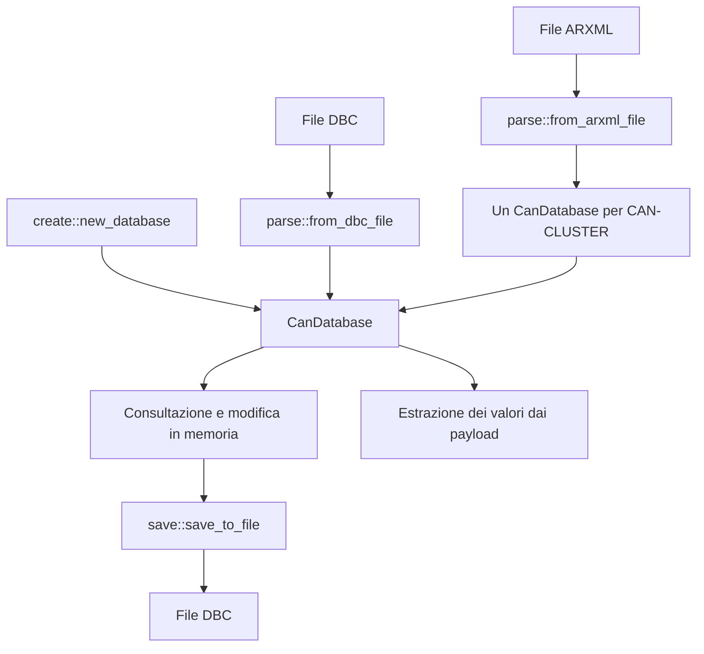

# can_tools

`can_tools` è una libreria Rust per leggere, creare, consultare, modificare e salvare database CAN. Un database descrive le ECU della rete, i messaggi che trasmettono e il modo in cui i segnali sono codificati nei payload.

Il modello centrale è `CanDatabase`: sia i file **DBC** sia i file **AUTOSAR ARXML** vengono importati in questa struttura. Le modifiche avvengono in memoria e l'esportazione produce un file **DBC**. La libreria offre anche funzioni per estrarre valori grezzi dai byte di un segnale e contenitori per le sue serie temporali.

Questo README descrive il codice presente nel repository, versione **2.1.6**, edition Rust **2024**, e serve come punto di partenza per comprenderlo e modificarlo.

**Ad ogni modifica al codice è necessario ricontrollare questo README e aggiornarlo se necessario**, verificando che API, funzionamento, esempi, test e limiti documentati corrispondano all'implementazione.

## Flusso generale



Le API principali sono:

| Operazione | Funzione | Risultato |
| --- | --- | --- |
| Creare un database | `create::new_database(name, bustype, version)` | `Result<CanDatabase, DbcCreateError>` |
| Leggere un DBC | `parse::from_dbc_file(path)` | `Result<CanDatabase, DbcParseError>` |
| Importare un ARXML | `parse::from_arxml_file(path)` | `Result<Vec<CanDatabase>, ArxmlConvertError>` |
| Salvare un DBC | `save::save_to_file(path, &db)` | `Result<(), DbcSaveError>` |

Il crate espone una libreria, senza un eseguibile. L'accesso all'hardware CAN, l'invio/ricezione dei frame e l'importazione dei log di traffico sono responsabilità dell'applicazione che lo utilizza.

## Modello dati

Le strutture sono definite in [`src/types`](src/types).

| Tipo | Contenuto principale |
| --- | --- |
| `CanDatabase` | Nome, versione, commento, `BusType`, nodi, messaggi, segnali, attributi, indici di ricerca e attributi delle relazioni. |
| `CanNode` | ECU con nome, commento, messaggi trasmessi (`messages_sent`), segnali trasmessi (`tx_signals`) e ricevuti (`rx_signals`). |
| `CanMessage` | ID numerico ed esadecimale, `IdFormat`, nome, lunghezza in byte, tipo di messaggio, trasmettitori, ricevitori, segnali e mappe di multiplexing. |
| `CanSignal` | Posizione e lunghezza in bit, endianness, tipo del valore, fattore, offset, limiti, unità, ricevitori, tabella valori, multiplexing e campioni temporali. |
| `AttributeSpec` | Definizione di un attributo: nome, ambito, tipo, limiti numerici o voci enum e valore predefinito. |
| `AttributeValue` | Valore concreto: `Str`, `Int`, `Hex`, `Float` oppure `Enum`. |

### Chiavi, indici e ordine

Nodi, messaggi e segnali sono conservati in tre `SlotMap`. Le relazioni usano le chiavi tipizzate `CanNodeKey`, `CanMessageKey` e `CanSignalKey`, anziché riferimenti Rust tra gli oggetti. Le chiavi rimangono stabili quando si aggiungono o riordinano elementi; la rimozione invalida la chiave dell'elemento eliminato. Sono identificatori interni al database in memoria e non vengono salvati nel DBC.

I vettori `nodes_order`, `messages_order` e `signals_order` determinano l'ordine degli iteratori pubblici `iter_nodes()`, `iter_messages()` e `iter_signals()`. Questi iteratori leggono esclusivamente i vettori d'ordine: non ripiegano sull'iterazione delle `SlotMap` quando un vettore è vuoto. I metodi `add_*` registrano anche le nuove chiavi nei relativi vettori.

Gli indici `HashMap` permettono ricerche per nome, ID numerico e ID esadecimale:

- I nomi di nodi, messaggi e segnali nelle ricerche globali sono normalizzati con `to_ascii_lowercase()`.
- Nomi dei nodi, nomi dei messaggi e ID numerici dei messaggi devono essere univoci nelle rispettive collezioni.
- `add_signal()` permette nomi duplicati; l'indice globale per nome conserva l'ultima chiave inserita. Per distinguere segnali omonimi, partire dal messaggio e usare `message.signals(&db)` oppure le sue chiavi.
- La ricerca esadecimale confronta la stringa esatta: usare `types::database::id_to_hex(id)`, ad esempio `0x100` oppure `0x00000801`. Il prefisso è `0x` e le cifre alfabetiche sono maiuscole. La normalizzazione automatica di input alternativi descritta in alcuni commenti del codice non è implementata.

I parser ordinano gli oggetti e le loro relazioni per nome al termine dell'importazione. Per riordinare dopo modifiche manuali sono disponibili `sort_db_nodes_by_name()`, `sort_db_messages_by_name()`, `sort_db_signals_by_name()` e i metodi `sort_all_*_fields()`.

### Relazioni tra gli oggetti

Un segnale appartiene al massimo a un messaggio, indicato da `signal.message`; una chiave nulla indica un segnale indipendente. Le relazioni vengono rappresentate anche sul lato opposto:

- `add_sender_relation(message, node)` aggiorna `message.sender_nodes`, `node.messages_sent` e `node.tx_signals`.
- `add_msg_sig_relation(signal, message, role, selector)` collega il segnale al messaggio, verifica il layout, compila l'estrazione dei bit e aggiorna trasmettitori, ricevitori e multiplexing.
- `add_sig_receiver_node(signal, node)` aggiorna `signal.receiver_nodes`, `node.rx_signals` e i ricevitori aggregati del messaggio.

Per creare un segnale completo, l'ordine consigliato è: **crearlo, impostarne posizione e lunghezza, associarlo al messaggio, aggiungere i ricevitori**. Le operazioni sulle relazioni possono effettuare modifiche prima di restituire un errore; non sono transazioni con rollback automatico.

## Esempi d'uso

Per usare il checkout locale da un altro progetto, aggiungere al suo `Cargo.toml` il percorso relativo corretto:

```toml
[dependencies]
can_tools = { path = "../can_tools" }
```

### Creare un database, aggiungere un segnale e decodificarlo

```rust,no_run
use can_tools::{
    create, save,
    types::{
        database::BusType,
        message::MuxRole,
        signal::{Endianness, Signess},
    },
};

fn main() -> Result<(), Box<dyn std::error::Error>> {
    let mut db = create::new_database("Powertrain", BusType::Can, "1.0")?;
    let engine = db.add_node("EngineECU")?;
    let dashboard = db.add_node("Dashboard")?;
    let message = db.add_message("EngineData", 0x100, 8)?;
    db.add_sender_relation(message, engine)?;

    // Parametri: nome, endian, segno, fattore, offset, minimo, massimo, unità.
    let speed = db.add_signal(
        "EngineSpeed", Endianness::Intel, Signess::Unsigned,
        0.25, 0.0, 0.0, 16_000.0, "rpm",
    );
    {
        let signal = db.get_sig_by_key_mut(speed).unwrap();
        signal.bit_start = 0;
        signal.bit_length = 16;
    }
    db.add_msg_sig_relation(speed, message, MuxRole::None, None)?;
    db.add_sig_receiver_node(speed, dashboard)?;

    // L'associazione al messaggio ha già compilato l'estrazione dei bit.
    let payload = [0xE0, 0x2E, 0, 0, 0, 0, 0, 0];
    let signal = db.get_sig_by_key(speed).unwrap();
    let raw = signal.extract_raw_u64(&payload);
    let rpm = raw as f64 * signal.factor + signal.offset;
    assert_eq!(raw, 12_000);
    assert_eq!(rpm, 3_000.0);

    save::save_to_file("output/powertrain.dbc", &db)?;
    Ok(())
}
```

`create::new_database()` richiede nome e versione non vuoti. Inizializza gli attributi `DBName` e `BusType`, imposta `Baudrate` a 500.000 bit/s e aggiunge metadati di data/versione basati sulla data locale. Con `BusType::CanFd` aggiunge anche `BaudrateCANFD` con valore assegnato di 2.000.000 bit/s. Le velocità del bus sono attributi, non campi dedicati di `CanDatabase`.

`add_message()` imposta inizialmente `msgtype` a `CAN` fino a 8 byte e a `CAN FD` oltre 8 byte. Questa scelta dipende dalla lunghezza, indipendentemente da `db.bustype`.

### Aprire, consultare e modificare un DBC

```rust,no_run
use can_tools::{parse, save};

fn main() -> Result<(), Box<dyn std::error::Error>> {
    let mut db = parse::from_dbc_file("examples/ABCAN_MEB.dbc")?;

    // La ricerca per nome ignora maiuscole/minuscole ASCII.
    if let Some(message) = db.get_message_by_name_mut("acc_19") {
        message.comment = "Messaggio aggiornato con can_tools".into();
    }

    for message in db.iter_messages() {
        println!("{} {}: {} byte", message.id_hex, message.name, message.byte_length);
        for signal in message.signals(&db) {
            println!("  {}: {}|{}", signal.name, signal.bit_start, signal.bit_length);
        }
    }

    save::save_to_file("output/ABCAN_MEB_edited.dbc", &db)?;
    Ok(())
}
```

Per accedere a un elemento si possono usare `get_node_by_name()`, `get_message_by_id()`, `get_message_by_name()`, `get_signal_by_name()` e i corrispondenti metodi mutabili. Le API con chiave usano i nomi `get_node_by_key()`, `get_message_by_key()` e `get_sig_by_key()`.

La modifica del commento nell'esempio non richiede aggiornamenti agli indici. Cambiare direttamente nomi, ID, chiavi di relazione o layout richiede invece di mantenere le strutture collegate: vedere le indicazioni per la manutenzione più avanti.

### Importare un ARXML

```rust,no_run
use can_tools::{parse, save};

fn main() -> Result<(), Box<dyn std::error::Error>> {
    let databases = parse::from_arxml_file("examples/HCP3_IO_Node.aRXml")?;
    for (index, db) in databases.iter().enumerate() {
        println!("Cluster {}: {} messaggi", db.name, db.messages.len());
        save::save_to_file(&format!("output/cluster_{index}.dbc"), db)?;
    }
    Ok(())
}
```

## Come avviene l'importazione

### DBC

`parse::from_dbc_file()` verifica l'estensione, apre il file e lo elabora riga per riga. Le righe vengono decodificate come **Windows-1252**; alcuni caratteri vengono traslitterati (`ü` → `u`, `ö` → `o`, `ä` → `a`, `ß` → `ss`, comprese le varianti maiuscole delle vocali).

Il parser riconosce il primo token e delega a funzioni interne in `core`. La sintassi dei nomi dei file/moduli segue quella delle sezioni DBC:

| Sezione | Informazioni importate |
| --- | --- |
| `VERSION` | Versione del database. |
| `BU_:` | Nodi/ECU. |
| `BO_` | Messaggio, ID, lunghezza e trasmettitore principale. |
| `SG_` | Segnale, layout, scala, limiti, unità, ricevitori e tag `M`/`mN`. |
| `BO_TX_BU_` | Trasmettitori aggiuntivi dei messaggi. |
| `CM_`, `CM_ BU_`, `CM_ BO_`, `CM_ SG_` | Commenti del database, dei nodi, dei messaggi e dei segnali. |
| `BA_DEF_`, `BA_DEF_DEF_`, `BA_` | Definizioni, valori predefiniti e assegnazioni degli attributi. |
| `BA_DEF_REL_`, `BA_DEF_DEF_REL_`, `BA_REL_` | Attributi delle relazioni nodo-segnale e nodo-messaggio. |
| `VAL_` | Associazioni tra valori interi e descrizioni del segnale. |
| `SIG_VALTYPE_` | Tipo IEEE float/double del segnale. |

Le righe `SG_` si riferiscono all'ultimo messaggio `BO_` riconosciuto, conservato nel campo interno `current_msg`. Le righe vuote, i commenti `//` e le sezioni non riconosciute vengono ignorati. I commenti multilinea dei nodi e dei segnali vengono ricomposti prima della decodifica. L'eventuale prefisso `Unit_` viene rimosso dall'unità del segnale.

È un parser tollerante: diverse anomalie causano il salto di una riga, l'uso di valori di ripiego o un errore interno ignorato. Un `Ok(db)` indica che il file è stato letto, ma non certifica che tutti gli elementi siano stati importati correttamente. Non viene restituito un elenco di diagnostiche sintattiche. L'ordine delle sezioni conta: oggetti e definizioni devono essere già disponibili quando vengono risolte le assegnazioni che li usano.

### ARXML

`parse::from_arxml_file()` usa `autosar-data` per caricare il modello e cercare i `CAN-CLUSTER`. Ogni cluster convertibile produce un database distinto. Il percorso di estrazione passa da canali fisici e `CAN-FRAME-TRIGGERING` ai frame, ai mapping PDU e infine ai segnali.

L'importatore ricava:

- Nome del cluster e tipo di bus, riconoscendo CAN FD dalla presenza di `CAN-FD-BAUDRATE`.
- Nome, ID e lunghezza dei frame.
- ECU trasmittenti/riceventi dai frame port e ulteriori trasmettitori da `ADMIN-DATA`/`NativeSender`.
- Segnali da `I-SIGNAL-I-PDU` e `NM-PDU`, con posizione, lunghezza, byte order e descrizione.
- Un segnale sintetico per gli `N-PDU`, esteso all'intera lunghezza della PDU.

La conversione è parziale: i segnali importati vengono inizializzati come unsigned con fattore `1.0` e offset `0.0`. Non vengono ricostruite tutte le informazioni AUTOSAR, tra cui conversioni fisiche, unità, attributi e strutture PDU arbitrarie. L'offset del mapping PDU nel frame non viene applicato alla posizione dei segnali. Il supporto non equivale quindi a una conversione completa e senza perdita di qualsiasi ARXML.

## Attributi, tabelle valori e multiplexing

Gli attributi distinguono la **definizione** (`AttributeSpec`, in `db.attr_spec`) dal **valore assegnato** (`attributes` del database o dell'oggetto). L'ambito è espresso da `AttrObject::{Database, Node, Message, Signal}`; i tipi da `AttrValueType::{String, Int, Hex, Float, Enum}`.

I metodi `add_attribute_definition()`, `edit_attribute_definition()` e `delete_attribute_definition()` propagano le modifiche agli oggetti dell'ambito interessato. I nuovi oggetti ricevono i default delle definizioni già registrate. La modifica di una definizione riconcilia i valori esistenti con tipo, limiti e voci enum; quelli incompatibili vengono sostituiti dal default. Il cambio di ambito viene rifiutato. Le definizioni normali sono indicizzate solo per nome: non esiste una chiave composta da nome e ambito.

Gli attributi relazionali usano invece `rel_attr_spec_bu_sg`, `rel_attr_spec_bu_bo`, `bu_sg_rel_attributes` e `bu_bo_rel_attributes`. I valori concreti sono associati a coppie di chiavi `(nodo, segnale)` o `(nodo, messaggio)`. Le relazioni con variabili d'ambiente `BU_EV_REL_` non sono implementate.

Le tabelle valori sono `BTreeMap<i32, String>` nei segnali; `add_value_table_entry()` e `remove_value_table_entry()` gestiscono le singole voci. Si tratta di etichette per valori grezzi, distinte dal fattore e dall'offset.

Il multiplexing è rappresentato da:

- `MuxRole::None`: segnale sempre presente.
- `MuxRole::Multiplexor`: segnale selettore, tag DBC `M`.
- `MuxRole::Multiplexed`: segnale condizionato dal selettore, tag DBC `mN`.
- `signal.mux_switch` e `signal.mux_selector`: selettore di riferimento e valore/intervallo richiesto.
- `message.mux_multiplexors` e `message.mux_cases`: selettori del messaggio e indice dei segnali per ciascun caso.

Quando nel messaggio esiste un solo multiplexor, l'associazione dei segnali multiplexed può dedurlo automaticamente. Il modello include `MuxSelector::Range`, ma il parser DBC riconosce solo `M` e `mN`; non gestisce `SG_MUL_VAL_` e non rilegge i tag a intervallo emessi dal writer. Il multiplexing esteso richiede ulteriore implementazione. L'estrazione raw di un singolo segnale non verifica se il suo caso di multiplexing è attivo.

## Decodifica dei payload e serie temporali

`CanSignal::compile_inline()` prepara una sequenza interna di estrazioni di bit, usata da `extract_raw_u64()` e `extract_raw_i64()`. L'associazione di un segnale a un messaggio svuota e ricompila questa cache. Sono presenti percorsi distinti per `Endianness::Intel` e `Endianness::Motorola`.

`extract_raw_u64()` restituisce il campo come intero unsigned; `extract_raw_i64()` applica l'estensione del segno quando `Signess::Signed` è impostato. Per i segnali interi la conversione fisica va applicata dal chiamante:

```text
valore_fisico = valore_raw * factor + offset
```

I metodi di estrazione rappresentano al massimo **64 bit**. Se il payload è incompleto, i byte mancanti vengono ignorati senza restituire un errore. `Signess::IeeeFloat` e `Signess::IeeeDouble` vengono letti e scritti tramite `SIG_VALTYPE_`, ma i metodi raw restituiscono comunque interi: la reinterpretazione IEEE dei bit compete al chiamante. L'importazione di `SIG_VALTYPE_` modifica tipo e lunghezza senza ricompilare automaticamente la cache.

`raws: Vec<(f64, i64)>` e `values: Vec<(f64, f64)>` conservano campioni con timestamp in secondi. Sono contenitori che l'applicazione deve popolare:

- `raw_value_at()` e `value_at()` cercano il primo campione entro una tolleranza di `0.001` secondi.
- Le varianti `*_at_relaxed()` restituiscono il campione temporalmente più vicino, senza limite massimo di distanza.
- Timestamp non finiti vengono esclusi. Non viene effettuata interpolazione.

I campioni non vengono serializzati nel DBC. In questo checkout non è presente il modulo `asc` citato da alcuni commenti sorgente.

## Salvataggio e limiti del round trip

`save::save_to_file()` richiede un percorso con estensione `.dbc`, crea le directory intermedie e scrive il database con un `BufWriter`. Un file già presente viene sovrascritto. Il writer ricostruisce il testo dalle strutture in memoria, nell'ordine degli iteratori e delle relazioni; non conserva il testo originale del file importato.

Vengono emesse le sezioni per nodi, messaggi, segnali, trasmettitori, commenti, attributi, attributi relazionali, tipi IEEE e tabelle valori. La presenza di una parola chiave nell'intestazione `NS_` generata non implica che il relativo costrutto sia implementato dal parser.

I segnali indipendenti vengono esportati in un messaggio sintetico chiamato `AUTONET__INDEPENDENT_SIG_MSG`, con ID `3221225479`, lunghezza `0` e trasmettitore di ripiego `AutoNet_XXX`. Questo espediente conserva le righe `SG_`, ma non garantisce che vengano riassociate correttamente a una successiva lettura, perché il controllo del layout usa la lunghezza del messaggio. Commenti, attributi e tabelle valori dei segnali indipendenti non seguono lo stesso percorso di esportazione dei segnali associati.

Altri limiti da considerare quando si modifica importazione/esportazione:

- Il writer emette UTF-8, mentre il reader interpreta Windows-1252: i testi non ASCII possono cambiare in un ciclo lettura/scrittura/lettura.
- I numeri floating point sono formattati con al massimo 12 cifre decimali dopo la virgola; non è garantita la conservazione di tutta la precisione `f64`.
- I default enum vengono letti come etichette da `BA_DEF_DEF_`, mentre il writer può emetterli come indici: il round trip dei default enum richiede verifica.
- La scrittura dei default relazionali consulta attualmente le definizioni normali di messaggi e segnali, anziché iterare direttamente le definizioni relazionali. Non si deve presumere la conservazione corretta di tutti i `BA_DEF_DEF_REL_`.
- Gli ID numerici DBC vengono memorizzati ed emessi come letti. `id_to_hex()` maschera a 29 bit gli ID oltre il range standard; `add_message()` sceglie `IdFormat::Extended` solo per `id > 2048`. La gestione del flag DBC per gli ID estesi e il caso limite `0x800` richiedono attenzione.

## Mappa del codice

| File o directory | Responsabilità |
| --- | --- |
| [`src/lib.rs`](src/lib.rs) | Moduli pubblici e re-export degli errori principali. |
| [`src/create.rs`](src/create.rs) | Costruzione del database e metadati iniziali. |
| [`src/parse.rs`](src/parse.rs) | Lettura DBC, dispatch dei decoder e conversione del modello AUTOSAR. |
| [`src/save.rs`](src/save.rs) | Serializzazione DBC, escaping, formattazione e messaggio sintetico per segnali indipendenti. |
| [`src/types/database.rs`](src/types/database.rs) | `CanDatabase`, chiavi, CRUD, copie, relazioni, indici, ordinamento e gestione delle definizioni degli attributi. |
| [`src/types/message.rs`](src/types/message.rs) | `CanMessage`, `IdFormat`, `MuxRole`, `MuxSelector` e tipi relativi ai messaggi. |
| [`src/types/signal.rs`](src/types/signal.rs) | `CanSignal`, endianness, `Signess`, cache di estrazione e interrogazione dei campioni. |
| [`src/types/node.rs`](src/types/node.rs) | `CanNode` e relazioni della ECU. |
| [`src/types/attributes.rs`](src/types/attributes.rs) | Definizioni, valori, tipi e ambiti degli attributi. |
| [`src/types/errors.rs`](src/types/errors.rs) | Errori di creazione, lettura, modifica, layout e salvataggio. |
| [`src/core`](src/core) | Decoder interni delle sezioni DBC; sottocartelle `attributes` e `comments`. |
| [`src/core/message_layout.rs`](src/core/message_layout.rs) | Funzione pubblica `check_signal_fits()`, usata per verificare che un segnale rientri nel messaggio. |
| [`tests/example_databases.rs`](tests/example_databases.rs) | Test d'integrazione sui database reali in `examples`, eseguiti automaticamente da `cargo test`. |

`core` è un modulo pubblico, ma quasi tutti i decoder al suo interno sono `pub(crate)`. I file vuoti `bu_bo_rel_.rs`, `bu_ev_rel_.rs` e `bu_sg_rel.rs` non sono registrati in `core/mod.rs`; il supporto attuale degli attributi relazionali risiede in `core/attributes`.

## Indicazioni per le modifiche future

Per orientarsi, partire dall'API di ingresso (`create`, `parse` o `save`), poi leggere i metodi coinvolti in `types/database.rs` e infine i tipi o decoder specifici. Quando i commenti del codice e l'implementazione differiscono, verificare il comportamento nel corpo delle funzioni.

Le principali invarianti da mantenere sono:

1. Ogni oggetto inserito deve comparire nella sua `SlotMap`, nel vettore d'ordine e negli indici pertinenti. Modificare direttamente un nome o un ID non aggiorna gli indici. Anche `db.name`/`db.bustype` e i valori degli attributi `DBName`/`BusType` possono divergere se modificati separatamente.
2. Un segnale associato deve comparire in `message.signals` e puntare allo stesso messaggio tramite `signal.message`. I metodi `remove_msg_sig_relation()` e `add_msg_sig_relation()` gestiscono il distacco e il nuovo collegamento.
3. Le relazioni di trasmissione e ricezione vanno aggiornate su tutti i lati, comprese le liste aggregate del messaggio e le strutture di multiplexing.
4. Modificare `bit_start`, `bit_length` o `endian` richiede di invalidare e ricompilare la cache. Richiamare soltanto `compile_inline()` su una cache già popolata non la aggiorna. `steps` è privato al crate; una nuova API di modifica del layout deve occuparsi anche di questo.
5. `check_signal_fits()` verifica lunghezza non nulla e limiti del frame, ma non controlla le sovrapposizioni tra segnali. Validazione e compilazione Motorola hanno percorsi distinti: verificare entrambe quando si interviene sull'ordine dei bit.

Le API di copia sono `copy_node()`, `copy_message()` e `copy_signal()`. Generano nomi con suffisso `_copy`; la copia di un messaggio cerca anche un nuovo ID e duplica i segnali. `copy_signal()` produce un segnale indipendente, da associare esplicitamente al messaggio desiderato.

Le API di cancellazione sono `delete_node()`, `delete_message()` e `delete_signal()`. La cancellazione di un messaggio mantiene i suoi segnali, rendendoli indipendenti. Il codice attuale non riallinea ogni struttura derivata in tutti i percorsi: ad esempio `delete_message()` non rimuove le voci dagli indici ID/esadecimale e `delete_signal()` non ricostruisce tutte le mappe mux o i ricevitori aggregati. Per richieste su cancellazioni o coerenza del database, partire da questi metodi e verificare i collegamenti residui.

## Errori e verifica del progetto

Gli errori sono definiti con `thiserror`:

| Errore | Ambito |
| --- | --- |
| `DbcCreateError` | Nome o versione vuoti durante la creazione. |
| `DbcParseError` | Estensione, apertura e lettura del DBC. |
| `ArxmlConvertError` | Estensione e caricamento del file AUTOSAR. |
| `DbcSaveError` | Percorso e scrittura del DBC. |
| `DatabaseError` | Duplicati, elementi mancanti, associazioni, attributi e operazioni sul modello. |
| `MessageLayoutError` | Segnale a lunghezza zero o fuori dai limiti del messaggio; convertibile in `DatabaseError::Layout`. |

`DatabaseError`, `DbcParseError` e `MessageLayoutError` sono riesportati alla radice del crate. Tutti i tipi di errore sono disponibili in `can_tools::types::errors`.

Comandi utili dalla radice del repository:

```sh
cargo check --locked
cargo test --locked
cargo doc --no-deps
```

`cargo test` esegue automaticamente i **9 test d'integrazione** in [`tests/example_databases.rs`](tests/example_databases.rs): otto casi per i file di esempio e un controllo che tutti i DBC/ARXML nella cartella abbiano un test. Per eseguire solo questa suite:

```sh
cargo test --locked --test example_databases
```

I file di esempio sono necessari: un input mancante causa il fallimento dei test. L'aggiunta, la rimozione o la rinomina di un DBC/ARXML in `examples` richiede di aggiornare i casi dichiarati in `example_tests!`. I percorsi degli input sono risolti a partire da `CARGO_MANIFEST_DIR`. Gli esempi Rust di questo README non sono inclusi automaticamente nei doctest del crate.

### Verifica con i file di esempio

Per le verifiche della libreria usare i file reali in [`examples`](examples). I test scrivono le esportazioni in directory temporanee distinte, eliminate al termine anche quando un test fallisce, e lasciano intatti gli input. I percorsi degli esempi Rust sopra sono invece relativi alla radice del repository.

I test verificano i seguenti conteggi attesi per gli **8 file**, che producono **10 database**:

| File di input | Database/cluster | Nodi | Messaggi | Segnali |
| --- | --- | ---: | ---: | ---: |
| [ABCAN_MEB.dbc](examples/ABCAN_MEB.dbc) | `E3V_ABCANFD` | 9 | 430 | 3705 |
| […_ABCANFD_…_20220718.dbc](examples/E3_1_1_UNECE_E3V_ABCANFD_KMatrix_V15.03.01.02F_20220718.dbc) | `E3V_ABCANFD` | 10 | 431 | 3705 |
| […_Klima.arxml](examples/E3_1_1_UNECE_Gen2_V15.04.06.02F_AR430_20250321_Klima.arxml) | `E3V_EVCANFD` | 27 | 218 | 1760 |
| […_SAM.arxml](examples/E3_1_1_UNECE_Gen2_V15.04.06.03F_AR430_20250326_SAM.arxml) | `E3V_CCAN` | 47 | 83 | 556 |
| […_SAM.arxml](examples/E3_1_1_UNECE_Gen2_V15.04.06.03F_AR430_20250326_SAM.arxml) | `E3V_K2CANFD` | 55 | 189 | 2391 |
| [HCP3_IO_Node.aRXml](examples/HCP3_IO_Node.aRXml) | `WU_HCP3_CANFD` | 3 | 5 | 109 |
| [HCP3_IO_Node.aRXml](examples/HCP3_IO_Node.aRXml) | `HCP3_CANFD01` | 18 | 144 | 775 |
| [ICAN_MLB.dBC](examples/ICAN_MLB.dBC) | `MLBevo_ICAN` | 13 | 569 | 4582 |
| […_K2CAN_…_VP.dbc](examples/MLBevo_Gen2_MLBevo_K2CAN_KMatrix_V8.24.01F_20220711_VP.dbc) | `MLBevo_K2CAN` | 8 | 397 | 3742 |
| [MQBw_ICANHS.dbc](examples/MQBw_ICANHS.dbc) | `ICANHS` | 16 | 498 | 3296 |

Per ogni database la suite controlla i conteggi attesi, gli iteratori, gli indici per nome dei nodi e dei messaggi, gli indici degli ID e i collegamenti tra messaggi, segnali, trasmettitori e ricevitori. Modifica un commento, esporta il database in DBC e lo rilegge. Verifica quindi i conteggi, il commento modificato e la conservazione di ID, nomi dei messaggi, lunghezze dei payload, layout dei segnali, segno, ruoli e selettori mux, trasmettitori e ricevitori. Le chiavi `SlotMap` non vengono confrontate tra database diversi: i segnali sono identificati dalle coppie `(ID messaggio, nome segnale)`.

Sui **24.431 segnali Intel associati, lunghi da 1 a 64 bit**, la suite confronta `extract_raw_u64()` e `extract_raw_i64()` con un'estrazione indipendente, un bit alla volta, usando quattro payload deterministici per segnale, sia prima sia dopo l'esportazione. Questi file non contengono segnali associati Motorola; i segnali oltre 64 bit sono esclusi dal confronto raw. I payload di prova sono generati: la verifica riguarda la decodifica dei layout reali, non acquisizioni di traffico CAN.

I test non verificano l'equivalenza completa di fattori e offset, attributi, testi e dati AUTOSAR originari; restano validi i limiti di importazione e round trip descritti sopra. Per nuove funzionalità, scegliere da `examples` gli input pertinenti, estendere i test sul comportamento modificato e ricontrollare questo README aggiornandolo se necessario. Modificare i conteggi attesi solo quando la variazione è giustificata da un cambiamento verificato del parser o degli input.

Le dipendenze dirette sono `autosar-data` (lettura AUTOSAR), `encoding_rs` (Windows-1252), `slotmap` (archiviazione con chiavi stabili), `chrono` (metadati temporali), `thiserror` (errori) e `serde` (dichiarata nel manifest). Non sono definite feature Cargo opzionali.

Licenza dichiarata in `Cargo.toml`: **MIT**.
